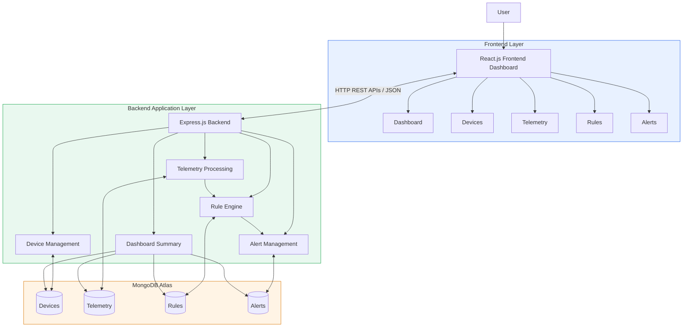
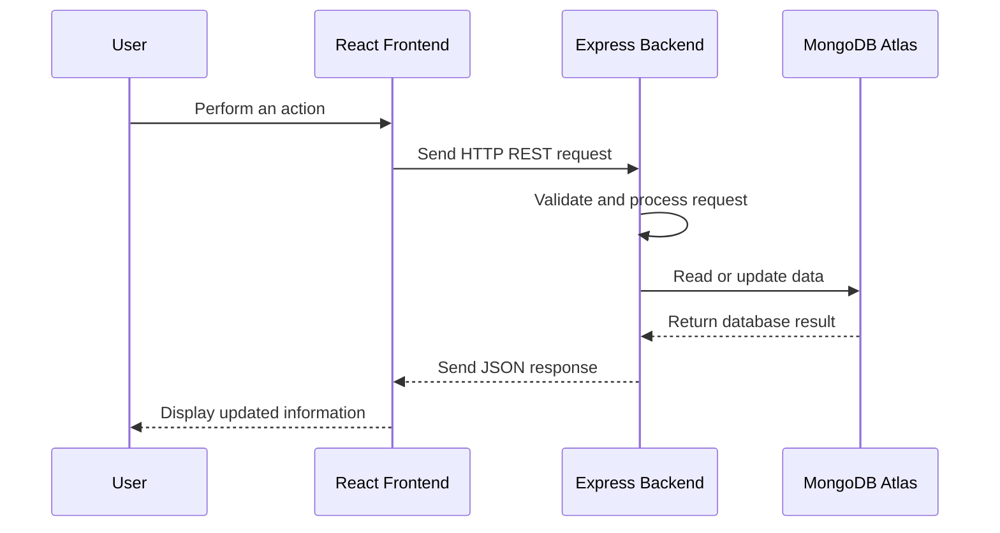
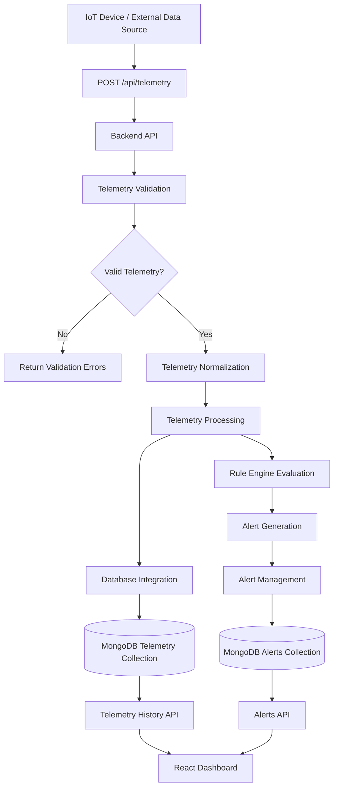
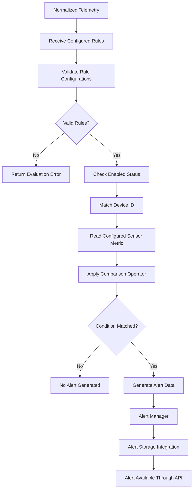

# NexusFlow – System Architecture

## 1. Project Overview

NexusFlow is an IoT Telemetry and Rule Engine platform designed to manage IoT devices, collect and process telemetry data, monitor device information, and generate alerts based on configurable monitoring conditions.

The platform provides a web-based dashboard that allows users to:

- Monitor registered IoT devices.
- View device information and status.
- Submit and retrieve telemetry records.
- Create, update, and manage monitoring rules.
- View generated alerts.
- Acknowledge and resolve alerts.
- Monitor application statistics through the dashboard.

The current architecture follows a modular client-server approach using React.js, Node.js, Express.js, and MongoDB Atlas.

Frontend-backend communication currently uses REST APIs with JSON-based request and response handling.

## 2. Technology Stack

| Layer | Technology | Purpose |
|---|---|---|
| Frontend | React.js | User interface and dashboard |
| Build Tool | Vite | Frontend development and production builds |
| Backend | Node.js | Server-side runtime |
| API Framework | Express.js | REST API development |
| Database | MongoDB Atlas | Persistent data storage |
| ODM | Mongoose | Database models and operations |
| Communication | REST APIs | Frontend-backend communication |
| Data Format | JSON | API request and response format |
| Testing | Node.js Test Runner | Backend automated testing |
| API Testing | Supertest | HTTP endpoint testing |

### Planned Technologies

The following technologies may be introduced in future development:

- MQTT for IoT device communication.
- Socket.IO for real-time dashboard updates.
- Redis Adapter for horizontal scaling.
- Chart.js or an equivalent library for advanced telemetry visualization.

These technologies are planned enhancements and are not part of the current implementation.

## 3. High-Level System Architecture

NexusFlow follows a layered architecture consisting of the frontend, backend API layer, application processing modules, and database.

### 3.1 Architecture Diagram



**Architecture Explanation:**

1. Users interact with the React.js frontend.
2. The frontend sends HTTP requests to the Express.js backend.
3. The backend routes requests to the appropriate application modules.
4. Telemetry Processing validates and normalizes incoming sensor data.
5. The Rule Engine evaluates telemetry against configured rules.
6. Alert Management handles generated alert information.
7. MongoDB Atlas stores application data through the backend database integration.
8. The frontend retrieves the required information through REST APIs.

## 4. System Components

### A. Frontend – React.js

The frontend provides the user interface for interacting with NexusFlow.

**Main responsibilities:**

- Display dashboard statistics.
- Show registered IoT devices.
- Display device information and status.
- Provide telemetry history.
- Support rule creation and management.
- Display generated alerts.
- Allow alert acknowledgement and resolution.
- Communicate with backend services through REST APIs.

**Main frontend pages:**

- Dashboard
- Devices
- Telemetry
- Rules
- Alerts

### B. Backend – Node.js and Express.js

The backend handles application logic, API requests, data processing, and database communication.

**Main responsibilities:**

- Handle frontend API requests.
- Manage device information.
- Receive and validate telemetry data.
- Normalize and process sensor readings.
- Coordinate telemetry storage.
- Execute configured monitoring rules.
- Generate alerts when rule conditions are matched.
- Manage alert records and status updates.
- Provide dashboard summary information.

### C. Database – MongoDB Atlas

MongoDB Atlas provides persistent storage for application data.

The application uses Mongoose for database models and database operations.

**Main collections:**

| Collection | Purpose |
|---|---|
| Devices | Stores registered device information |
| Telemetry | Stores sensor readings and telemetry history |
| Rules | Stores configured monitoring conditions |
| Alerts | Stores generated alerts and their status |

### D. Telemetry Processing Module

The Telemetry Processing module validates, normalizes, and processes incoming sensor data.

**Main responsibilities:**

- Validate telemetry object structure.
- Validate device identifiers.
- Validate numeric sensor readings.
- Validate optional timestamps.
- Normalize device identifiers.
- Convert timestamps into ISO 8601 format.
- Coordinate Rule Engine integration.
- Collect generated alerts.

The processing module is organized into:

- `telemetryValidator.js`
- `telemetryNormalizer.js`
- `telemetryProcessor.js`

Telemetry persistence is handled through the backend API and database integration layer rather than directly by the core Telemetry Processor.

### E. Rule Engine

The Rule Engine evaluates telemetry readings against configured monitoring rules.

**Main responsibilities:**

- Validate rule configurations.
- Identify rules associated with the telemetry device.
- Check whether rules are enabled.
- Retrieve the configured telemetry metric.
- Compare sensor values against configured thresholds.
- Generate alerts when conditions are matched.

The current implementation supports five comparison operators:

- `>`
- `<`
- `==`
- `>=`
- `<=`

Supported alert severity levels:

- Warning
- Critical

### F. Alert Management

The Alert Management module handles alert creation and status management.

**Main responsibilities:**

- Create alert records.
- Store generated alerts.
- Retrieve alert information.
- Acknowledge alerts.
- Resolve alerts.
- Maintain alert status information.

## 5. Frontend and Backend Communication

The frontend communicates with the backend using HTTP REST APIs.

JSON is used for exchanging data between the frontend and backend.

### Communication Workflow



### Device APIs

| Method | Endpoint | Purpose |
|---|---|---|
| GET | `/api/devices` | Retrieve all devices |
| POST | `/api/devices` | Register a device |
| GET | `/api/devices/:deviceId` | Retrieve a specific device |
| PUT | `/api/devices/:deviceId` | Update device information |
| DELETE | `/api/devices/:deviceId` | Delete a device |

### Telemetry APIs

| Method | Endpoint | Purpose |
|---|---|---|
| POST | `/api/telemetry` | Submit telemetry data |
| GET | `/api/telemetry` | Retrieve telemetry history |

### Rule APIs

| Method | Endpoint | Purpose |
|---|---|---|
| POST | `/api/rules` | Create a monitoring rule |
| GET | `/api/rules` | Retrieve all rules |
| GET | `/api/rules/:ruleId` | Retrieve a specific rule |
| PUT | `/api/rules/:ruleId` | Update a rule |
| DELETE | `/api/rules/:ruleId` | Delete a rule |

### Alert APIs

| Method | Endpoint | Purpose |
|---|---|---|
| GET | `/api/alerts` | Retrieve generated alerts |
| PATCH | `/api/alerts/:alertId/status` | Update alert status |

### Dashboard API

| Method | Endpoint | Purpose |
|---|---|---|
| GET | `/api/dashboard/summary` | Retrieve dashboard statistics |

### Health Check API

| Method | Endpoint | Purpose |
|---|---|---|
| GET | `/health` | Check backend server status |

## 6. Telemetry Data Flow

Telemetry Processing is responsible for validating and preparing incoming sensor data for monitoring and rule evaluation.

### Telemetry Processing Workflow



### Processing Steps

1. An IoT device or external source submits telemetry data.
2. The backend receives the request through `POST /api/telemetry`.
3. The Telemetry Validator checks the incoming data.
4. Invalid data is rejected with appropriate validation errors.
5. Valid data is normalized.
6. The backend coordinates telemetry persistence.
7. The Rule Engine evaluates the telemetry against configured rules.
8. Matching conditions produce alert information.
9. Alert Management handles generated alerts and database integration.
10. The frontend retrieves telemetry history and alert information through REST APIs.

The exact processing and persistence operations are coordinated by the backend integration layer.

## 7. Rule Engine Integration

The Rule Engine is integrated with the telemetry processing workflow.

### Rule Evaluation Workflow



### Rule Evaluation Example

Consider the following monitoring rule:

```json
{
  "ruleId": "RULE_001",
  "ruleName": "High Temperature",
  "deviceId": "DEVICE_001",
  "metric": "temperature",
  "operator": ">",
  "threshold": 40,
  "severity": "Critical",
  "enabled": true
}
```

Incoming telemetry:

```json
{
  "deviceId": "DEVICE_001",
  "temperature": 42,
  "humidity": 28
}
```

Since the temperature value is greater than the configured threshold, the Rule Engine generates a Critical alert.

## 8. Data Integration

The system uses MongoDB models to maintain structured application data.

| Data Entity | Stored Information |
|---|---|
| Device | Device identifiers, information, and status |
| Telemetry | Sensor readings and timestamps |
| Rule | Monitoring conditions and configurations |
| Alert | Generated alert information and status |

Mongoose is used to interact with MongoDB Atlas.

The backend manages database operations and provides the corresponding information through REST APIs.

## 9. Error Handling

The system includes validation and error handling for different application operations.

Examples include:

- Invalid API requests.
- Invalid telemetry objects.
- Missing device identifiers.
- Invalid sensor readings.
- Invalid timestamps.
- Invalid rule configurations.
- Unsupported comparison operators.
- Missing device information.
- Database operation failures.
- Unexpected server errors.

Appropriate error responses help maintain application reliability and data consistency.

## 10. Security Considerations

Security is an important consideration for the NexusFlow platform.

Current and planned considerations include:

- Store database credentials in environment variables.
- Avoid committing `.env` files.
- Validate incoming API requests.
- Validate telemetry payloads.
- Prevent unnecessary exposure of sensitive information.
- Introduce authentication and authorization.
- Implement role-based access control.
- Protect device and telemetry information.

**Current limitation:** Authentication and role-based access control are not yet implemented.

## 11. Current Implementation Status

The following components are currently implemented:

### Frontend

- React-based dashboard.
- Dashboard summary interface.
- Device management interface.
- Telemetry interface.
- Rule management interface.
- Alert management interface.

### Backend

- Node.js and Express.js server.
- Device management APIs.
- Telemetry ingestion and history APIs.
- Rule creation and management APIs.
- Alert retrieval and status management APIs.
- Dashboard summary API.
- Backend validation and error handling.

### Data Processing

- Telemetry validation.
- Telemetry normalization.
- Multiple numeric sensor metric support.
- Optional timestamp validation.
- Automatic timestamp generation.
- Rule Engine integration.
- Automatic alert generation.

### Database

- MongoDB Atlas integration.
- Mongoose-based models.
- Device data storage.
- Telemetry data storage.
- Rule data storage.
- Alert data storage.

### Automated Testing

The latest backend automated test execution reported:

| Test Result | Count |
|---|---:|
| Total Tests | 90 |
| Passed | 90 |
| Failed | 0 |
| Skipped | 0 |

**Backend verification: Successful — 90/90 tests passed.**

### Current Limitations

The following capabilities are not currently implemented:

- MQTT-based IoT communication.
- Socket.IO-based real-time updates.
- Live telemetry broadcasting.
- Real-time alert notifications.
- Authentication and role-based access control.
- Advanced telemetry visualization.
- Cloud deployment.

## 12. Future Improvements

Potential future improvements include:

- MQTT-based IoT device communication.
- Socket.IO-based real-time dashboard updates.
- Live telemetry monitoring.
- Automatic device status notifications.
- Advanced telemetry visualization.
- Time-series analytics.
- AI-based anomaly detection.
- Advanced alert notifications.
- Authentication and role-based access control.
- Redis-based horizontal scaling.
- Cloud deployment.
- Complete end-to-end testing.

These improvements are planned enhancements and should not be considered part of the current implementation.

## 13. Conclusion

NexusFlow integrates frontend dashboard functionality, backend REST APIs, MongoDB data storage, telemetry processing, rule evaluation, and alert management into a unified IoT monitoring platform.

Its modular architecture provides a foundation for managing IoT devices, processing sensor readings, evaluating configurable monitoring rules, and generating alerts automatically.

The current implementation provides a functional REST API-based monitoring system with successful backend automated testing.

Future development can extend this architecture with real-time communication, MQTT integration, advanced analytics, stronger security, and cloud-based infrastructure.